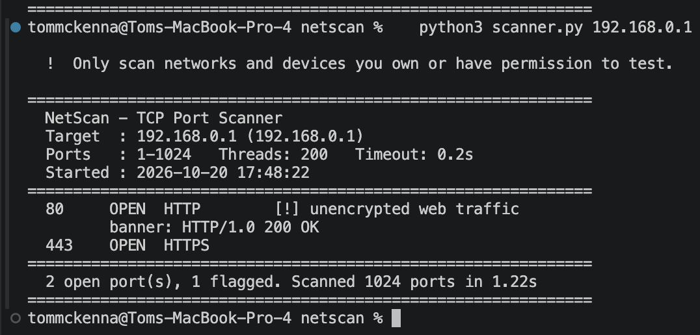

# NetScan — Network Port Scanner

A Python command-line tool that scans a target IP for open TCP ports,
identifies the services running on them, and flags security risks.
Built as a personal cyber security project to demonstrate TCP/IP
networking, socket programming and concurrency
to demonstrate understanding of network fundamentals.

# How to run
open any terminal and enter the following:
python3 scanner.py <Desired IP Address> 

Enter any IP address if you havent already, when prompted. Only use on networks you own.
Optional: `-p 1-65535` port range, `-t` threads, `--timeout` seconds,
`-o report.json` to save results.

# What it does

- Scans ports 1–1024 concurrently using a thread pool
- Identifies services and grabs a one-line banner from open ports
- Flags risky services (FTP, Telnet, SMB, RDP, VNC) with the reason
- Exports results to JSON

# Tech used

- Python 3 (standard library only: socket, concurrent.futures, argparsee and JSON)
- socket library (built-in)

## Performance Upgrade Since Last Version
Scanning 1,024 ports on my home router dropped from ~5s (sequential) to
~1.2s (~75% faster) with identical results. Scan time scales roughly with
ports ÷ threads × timeout, so the defaults (200 threads, 0.2s timeout) are
tuned for local networks. For slower or remote targets, raise the timeout.

## In progress
- Flask dashboard: a web view of scan results with exportable reports

# Legal notice

Only scan IP addresses and networks you own or have explicit permission
to scan. Unauthorised port scanning may be illegal under the Computer
Misuse Act.
